# Software-term-project-

## BuildSupply Hub website sitemap

Blue nodes are the proposed P0 MVP. Gray nodes are outside the MVP and have no committed release order. Replace each `[ผู้รับผิดชอบ: ___]` placeholder with the responsible team member's name.

```mermaid
flowchart TB
    Home["Home<br/>[ผู้รับผิดชอบ: ___]"] --> SignIn["Sign in<br/>[ผู้รับผิดชอบ: ___]"]
    SignIn --> Buyer["Buyer workspace<br/>[ผู้รับผิดชอบ: ___]"]
    SignIn --> Supplier["Supplier portal<br/>[ผู้รับผิดชอบ: ___]"]
    SignIn --> Operator["Platform operations<br/>[ผู้รับผิดชอบ: ___]"]

    Buyer --> Roles["Roles and access · US01<br/>[ผู้รับผิดชอบ: ___]"]
    Buyer --> RFQ["Material need and RFQ invitations · US03, US05<br/>[ผู้รับผิดชอบ: ___]"]
    Buyer --> Compare["Compare quotes · US08<br/>[ผู้รับผิดชอบ: ___]"]
    Buyer --> Approval["PO approval and issue · US10, US11<br/>[ผู้รับผิดชอบ: ___]"]
    Buyer --> Receiving["Arrival and inspection · US14, US15<br/>[ผู้รับผิดชอบ: ___]"]
    Buyer --> Payment["Checkout, return and refund · US17, US18<br/>[ผู้รับผิดชอบ: ___]"]
    Buyer --> History["Private supplier history · US22<br/>[ผู้รับผิดชอบ: ___]"]

    Supplier --> Quote["Submit and revise quote · US06<br/>[ผู้รับผิดชอบ: ___]"]
    Supplier --> POReply["Acknowledge or decline PO · US11<br/>[ผู้รับผิดชอบ: ___]"]
    Supplier --> Status["Declare dispatch or delay · US13<br/>[ผู้รับผิดชอบ: ___]"]
    Supplier --> Payout["Payment and payout view · US19<br/>[ผู้รับผิดชอบ: ___]"]
    Operator --> Fees["Hub fee ledger · US20<br/>[ผู้รับผิดชอบ: ___]"]

    Buyer -.-> Projects["Projects and supplier contacts · US02, US04<br/>[ผู้รับผิดชอบ: ___]"]
    Buyer -.-> Sourcing["External quotes and selection record · US07, US09<br/>[ผู้รับผิดชอบ: ___]"]
    Buyer -.-> Changes["PO amendments and cancellation · US12<br/>[ผู้รับผิดชอบ: ___]"]
    Buyer -.-> Issues["Issue resolution and corrections · US16, US23<br/>[ผู้รับผิดชอบ: ___]"]
    Buyer -.-> Reports["Audit, export and premium tools · US24, US26<br/>[ผู้รับผิดชอบ: ___]"]
    Buyer -.-> Map["Live shipment map · US29<br/>[ผู้รับผิดชอบ: ___]"]
    Supplier -.-> Statements["Detailed supplier statements · US21<br/>[ผู้รับผิดชอบ: ___]"]
    Operator -.-> Support["Scoped support access · US25<br/>[ผู้รับผิดชอบ: ___]"]
    Operator -.-> AdsAdmin["Sponsored display management · US27<br/>[ผู้รับผิดชอบ: ___]"]
    SignIn -.-> AdsView["Labeled sponsored display · US28<br/>[ผู้รับผิดชอบ: ___]"]

    LegendP0["Blue: P0 MVP"] ~~~ LegendFuture["Gray: outside MVP; no release order"]
    classDef core fill:#DBEAFE,stroke:#2563EB,color:#0F172A
    classDef future fill:#E5E7EB,stroke:#6B7280,color:#111827
    classDef nav fill:#F8FAFC,stroke:#64748B,color:#0F172A
    class Home,SignIn,Buyer,Supplier,Operator nav
    class Roles,RFQ,Compare,Approval,Receiving,Payment,History,Quote,POReply,Status,Payout,Fees,LegendP0 core
    class Projects,Sourcing,Changes,Issues,Reports,Map,Statements,Support,AdsAdmin,AdsView,LegendFuture future
```

